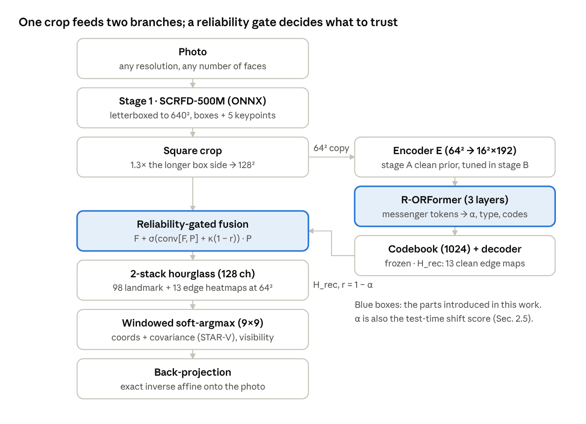

# ARMOR-FLD — Face Landmark Detection Under Adverse Conditions

**A**dverse-condition **R**eliability-**M**odulated **OR**Former for **F**ace **L**andmark **D**etection: a two-stage
pipeline (SCRFD → reliability-aware ORFormer → lite hourglass) that learns *where an image can be trusted* and uses that
signal in the feature fusion, in the loss and at test time. It comes with **WFLW-C**, a 5-family × 5-severity
adverse-condition protocol for WFLW, and runs end to end from one Colab notebook or from plain scripts.

<p align="center"></p>

**Headline result.** Training with the degradation bank and its reliability supervision cuts the error under adverse
conditions by 30 % (mean WFLW-C NME **9.74 %** vs 13.97 % without the bank) at **no cost on clean faces**
(5.52 % vs 5.54 % NME on WFLW), with an 8.2 M-parameter model trained for 75 minutes on a Colab T4.

[](https://colab.research.google.com/github/USER/armor-fld/blob/main/notebooks/ARMOR_FLD_colab.ipynb)
&nbsp;·&nbsp; `notebooks/ARMOR_FLD_colab.ipynb`
---

## What is new

| Component | Baseline (ORFormer + STAR) | ARMOR-FLD |
|---|---|---|
| Training corruption | none (ORFormer uses synthetic occlusion for its messenger tokens) | **Degradation bank**: occlusion, blur, low light, weather, compression, each with a per-pixel *unreliability map* `u` |
| Recovery transformer | messenger tokens flag occluded patches, blend weight α unsupervised | **R-ORFormer**: α supervised against `u` (BCE), degradation-type head whose embedding conditions the messenger tokens, previous-layer α biases the attention logits (`log(1−α)`) |
| Fusion of recovered heatmaps | fixed add / concat | **Reliability-gated fusion** `g = σ(conv[F,P] + κ(1−r))`: the clean prior is mixed in only where the image is unreliable |
| Loss | STAR (anisotropic, per-landmark) | **STAR-V**: STAR weighted by the visibility target, warm-up and peak gate, + a **visibility head** that outputs a per-landmark visibility score |
| Test time | — | **Shift score** (mean predicted unreliability, z-scored on clean faces) that gates a label-free **PG-TTA** (prior consistency + flip equivariance + entropy) |
| Benchmark | WFLW subsets | **WFLW-C** (5 families × 5 severities, deterministic per image, with unreliability / visibility targets) |

The shift *detector* works (z ≈ 0 on clean faces, 1–9 on corrupted ones); the gradient-based *adaptation* does **not**
improve accuracy on this detector and is reported as a negative result (see below). Details are in the report.

## Repository layout

```
armor/                     the package (13 modules; see armor/README.md)
  config.py                QUICK / FULL presets, get_config(name, **overrides)
  degrade.py               degradation bank + WFLW-C corruption generator
  vq.py  orformer.py       stage A clean-face VQ prior, stage B R-ORFormer
  fld.py  losses.py        stage C landmark net (gated fusion, visibility head), STAR-V / AWing losses
  tta.py                   shift detector + PG-TTA
  detector.py              SCRFD-500M (ONNX) + the detect → crop → landmark → back-project pipeline
  train.py  metrics.py     training loops, evaluation, WFLW-C benchmark
scripts/
  train.py                 stages A → B → C, then WFLW evaluation
  evaluate.py              WFLW subsets, WFLW-C grid, optional TTA table
  ablate.py                retrain B + C with one component removed
  demo.py                  run the full pipeline on a photo
  export_onnx.py           ONNX export + size / latency
notebooks/ARMOR_FLD_colab.ipynb   the same code as a single Colab notebook (Drive checkpoints, resumable)
results/                   result JSON files from the reported runs
assets/pipeline.png        pipeline figure
```

## Quick start

### 1. Install

```bash
git clone https://github.com/USER/armor-fld.git
cd armor-fld
pip install -r requirements.txt
```

Python ≥ 3.9, PyTorch ≥ 2.1. A GPU is needed for real training (the FULL schedule takes ~95 min on a T4); the
`--synthetic` code check runs on a CPU in a few minutes.

### 2. Code check (no data needed)

```bash
python scripts/train.py       --synthetic --out-dir runs/synthetic                 # ~1 min on a 2-core CPU
python scripts/evaluate.py    --synthetic --out-dir runs/synthetic --severities 3  # add --tta for the TTA table (slow on CPU)
python scripts/ablate.py      --synthetic --out-dir runs/synthetic --name no_degradation_bank --severities 3
python scripts/export_onnx.py --synthetic --out-dir runs/synthetic
python scripts/demo.py        --synthetic --out-dir runs/synthetic                 # downloads SCRFD, writes runs/synthetic/demo_synthetic_face.jpg
```

On a machine without a GPU, `--synthetic` switches to a small model and one epoch per stage automatically.
Numbers from a synthetic run only show that the code runs; they mean nothing for WFLW.

### 3. Data

```
data/WFLW/
  WFLW_images/                    6,551 JPEGs from WIDER FACE  (official: WFLW_images.tar.gz, ~725 MB)
  WFLW_annotations/
    list_98pt_rect_attr_train_test/
      list_98pt_rect_attr_train.txt
      list_98pt_rect_attr_test.txt
```

* Images: `WFLW_images.tar.gz` from the [WFLW page](https://wywu.github.io/projects/LAB/WFLW.html)
  (Google Drive id `1hzBd48JIdWTJSsATBEB_eFVvPL1bx6UC`).
* Annotations: the official link returned 404 in October 2026; use the
  [Internet Archive copy](https://web.archive.org/web/20260103234337id_/https://wywu.github.io/projects/LAB/support/WFLW_annotations.tar.gz).
* The SCRFD-500M detector (`det_500m.onnx`, InsightFace `buffalo_sc` pack) is downloaded by `scripts/demo.py` on first use.

### 4. Train and evaluate

```bash
# QUICK: 1,500 faces, 4/4/15 epochs, ~20 min on a T4 — checks the pipeline, numbers not comparable
python scripts/train.py --mode QUICK --data-root data/WFLW --out-dir runs/quick

# FULL: all 7,500 faces, 30/20/60 epochs, ~95 min on a T4 — the reported numbers
python scripts/train.py    --mode FULL --data-root data/WFLW --out-dir runs/full
python scripts/evaluate.py --mode FULL --data-root data/WFLW --out-dir runs/full --severities 1 3 5 --tta
python scripts/ablate.py   --mode FULL --data-root data/WFLW --out-dir runs/full --name no_degradation_bank
python scripts/export_onnx.py --mode FULL --out-dir runs/full
python scripts/demo.py     --mode FULL --out-dir runs/full --image photo.jpg --save demo.jpg
```

Finished stages are loaded from `--out-dir` instead of retrained, so an interrupted run only loses the current stage.
Any config value can be overridden on the command line, e.g. `--set crop_size=256 hg_stacks=4 c_epochs=100`.

### 5. Colab

Open `notebooks/ARMOR_FLD_colab.ipynb`, set `MODE = "FULL"` and `WFLW_DRIVE_DIR` (a Drive folder holding
`WFLW_images.tar.gz`) in the configuration cell, and run all cells. Checkpoints and result files go to
`MyDrive/ARMOR_FLD/<mode>/`.

## Results (FULL configuration, single run, 2,500 WFLW test faces)

### WFLW

| Subset | Faces | NME % | FR@0.1 % | AUC@0.1 |
|---|---:|---:|---:|---:|
| Full | 2,500 | **5.52** | 8.48 | 0.510 |
| Pose | 326 | 10.94 | 31.90 | 0.210 |
| Expression | 314 | 6.16 | 8.92 | 0.470 |
| Illumination | 698 | 5.44 | 7.02 | 0.522 |
| Make-up | 206 | 5.79 | 9.22 | 0.503 |
| Occlusion | 736 | 7.31 | 16.71 | 0.412 |
| Blur | 773 | 6.29 | 9.57 | 0.457 |

128² input, two lite hourglass stacks (depth 3, 128 ch), 8.2 M parameters, 75 min of stage-C training on one T4.
Published 256² four-stack models (ORFormer + HG, STAR) reach ≈ 4 % full-set NME; the code is resolution-agnostic
(`--set crop_size=256 hg_stacks=4`).

### WFLW-C and the degradation-bank ablation

NME % per cell; "no bank" retrains stages B and C with `p_degrade = 0`, everything else identical.

| Cell | ARMOR-FLD | no bank | Δ | FR % | Vis. acc. |
|---|---:|---:|---:|---:|---:|
| Clean | 5.52 | 5.54 | +0.02 | 8.48 | – |
| Occlusion 1 / 3 / 5 | 6.16 / 10.34 / 18.72 | 6.40 / 13.74 / 28.42 | +0.24 / +3.40 / +9.70 | 10.1 / 28.4 / 61.6 | 0.75 / 0.84 / 0.84 |
| Blur 1 / 3 / 5 | 5.95 / 7.57 / 9.67 | 6.16 / 9.19 / 13.96 | +0.21 / +1.62 / +4.29 | 10.1 / 17.1 / 26.6 | – |
| Low light 1 / 3 / 5 | 6.04 / 9.15 / 16.35 | 6.76 / 17.36 / 32.36 | +0.72 / +8.21 / +16.01 | 10.8 / 22.4 / 45.1 | – |
| Weather 1 / 3 / 5 | 5.55 / 5.81 / 6.39 | 5.66 / 6.25 / 7.83 | +0.11 / +0.44 / +1.44 | 8.4 / 9.8 / 12.4 | – |
| Compression 1 / 3 / 5 | 6.06 / 8.54 / 23.80 | 6.42 / 11.21 / 37.83 | +0.36 / +2.67 / +14.03 | 10.8 / 20.2 / 75.6 | – |
| **Mean corrupted (15 cells)** | **9.74** | **13.97** | **+4.23** | | |

The bank's benefit is zero on clean faces and grows with severity (+0.1–0.7 points at severity 1, +1.4–16 points at
severity 5). Visibility accuracy (balanced, threshold 0.5) is only meaningful under occlusion, where the target varies
across landmarks.

### Shift detection and test-time adaptation

Shift score = mean predicted unreliability α of a batch, z-scored against clean training crops (μ = 0.058, σ = 0.070).
NME % without TTA, with the gated PG-TTA (0–4 episodic steps chosen by z), forced (always 2 steps) and online
(parameters carried across batches):

| Cell | z | steps | no TTA | gated | forced | online |
|---|---:|---:|---:|---:|---:|---:|
| Clean | −0.2 | 0.07 | 5.52 | 5.51 | 5.50 | 5.52 |
| Occlusion 1 / 3 / 5 | 0.2 / 1.6 / 3.0 | 0.4 / 3.2 / 4.0 | 6.16 / 10.34 / 18.72 | 6.15 / 10.48 / 18.86 | 6.16 / 10.40 / 18.72 | 6.38 / 12.91 / 22.15 |
| Blur 1 / 3 / 5 | 1.1 / 5.9 / 8.1 | 2.3 / 4.0 / 4.0 | 5.95 / 7.57 / 9.67 | 5.93 / 7.60 / 9.63 | 5.93 / 7.55 / 9.60 | 6.65 / 8.99 / 11.08 |
| Low light 1 / 3 / 5 | 1.9 / 5.3 / 8.1 | 3.7 / 4.0 / 4.0 | 6.04 / 9.15 / 16.35 | 6.04 / 9.25 / 16.50 | 6.03 / 9.15 / 16.27 | 6.98 / 10.89 / 18.57 |
| Weather 1 / 3 / 5 | 0.7 / 4.5 / 7.4 | 1.4 / 4.0 / 4.0 | 5.55 / 5.81 / 6.39 | 5.54 / 5.80 / 6.37 | 5.54 / 5.78 / 6.35 | 6.06 / 6.90 / 7.58 |
| Compression 1 / 3 / 5 | 0.8 / 6.1 / 9.2 | 1.9 / 4.0 / 4.0 | 6.06 / 8.54 / 23.80 | 6.05 / 8.62 / 23.65 | 6.06 / 8.54 / 23.63 | 6.77 / 10.23 / 24.64 |

* **Detector: positive.** The gate spends 0.07 steps on clean faces and the full 4 steps on heavily degraded ones.
  The codebook quantisation error used in the original design does *not* work as a shift signal (z ≤ 0.5 everywhere,
  negative for blur, low light and compression) and was replaced by α.
* **Adaptation: negative.** Two episodic steps change NME by at most 0.17 points; online adaptation degrades every
  corrupted cell by 1–2.5 points. Keep the shift score as a quality flag, skip the adaptation in production.

### Efficiency

| | |
|---|---|
| Landmark model | 8.2 M parameters (7.2 M deployable — the frozen encoder copy for the VQ gate can be dropped), 30 MB fp32 ONNX, 11.3 GFLOPs / 128² face |
| SCRFD-500M | 0.6 M parameters, 2.5 MB ONNX |
| CPU, 2 threads, onnxruntime fp32 | detector 27 ms / 640² image, landmarks 112 ms / face (b = 1) |
| Training (Colab T4) | stage A 5 min, B 15 min, C 75 min; evaluation incl. TTA ≈ 2 h |

### Summary of evidence

| Claim | Status |
|---|---|
| Credible clean accuracy for the model size | met — 5.52 % NME, 0.510 AUC |
| Degradation bank causes the robustness | met — +4.23 mean corrupted NME without it, +0.02 on clean |
| Reliability outputs are informative | met — visibility 0.75–0.84 under occlusion; z separates every corrupted cell |
| VQ quantisation error detects shift | refuted |
| Test-time adaptation improves accuracy | not supported (≤ 0.17 episodic, −1 to −2.5 online) |
| Reliability supervision adds to plain augmentation | open — `scripts/ablate.py --name no_reliability_supervision` |

## Limitations

Single seed per number (differences below ~0.2 NME points are within seed noise; the 4.2-point ablation gap is not);
128² / two-stack model, 1.5 points behind published 256² four-stack models; WFLW-C corruptions are synthetic and the
visibility targets come from the same generator (COFW is the natural next test); only one TTA objective family and
learning rate were tried; single-frame only.

## Citation

```bibtex
@misc{rakshit2026armorfld,
  title  = {ARMOR-FLD: Face Landmark Detection Under Adverse Conditions with a Reliability-Modulated ORFormer},
  author = {Rakshit, Sayan},
  year   = {2026},
  url    = {https://github.com/SayanRakshit/armor-fld}
}
```

Built on: SCRFD (Guo et al., ICLR 2022), ORFormer (Chiang et al., WACV 2025), STAR loss (Zhou et al., CVPR 2023),
WFLW (Wu et al., CVPR 2018), Adaptive Wing loss (Wang et al., ICCV 2019), stacked hourglass (Newell et al., ECCV 2016),
VQ-VAE (van den Oord et al., NeurIPS 2017), Tent (Wang et al., ICLR 2021), ImageNet-C (Hendrycks & Dietterich, ICLR 2019).
SCRFD weights are the InsightFace release and keep their licence; WFLW is for non-commercial research use.

## License

MIT — see [LICENSE](LICENSE).
